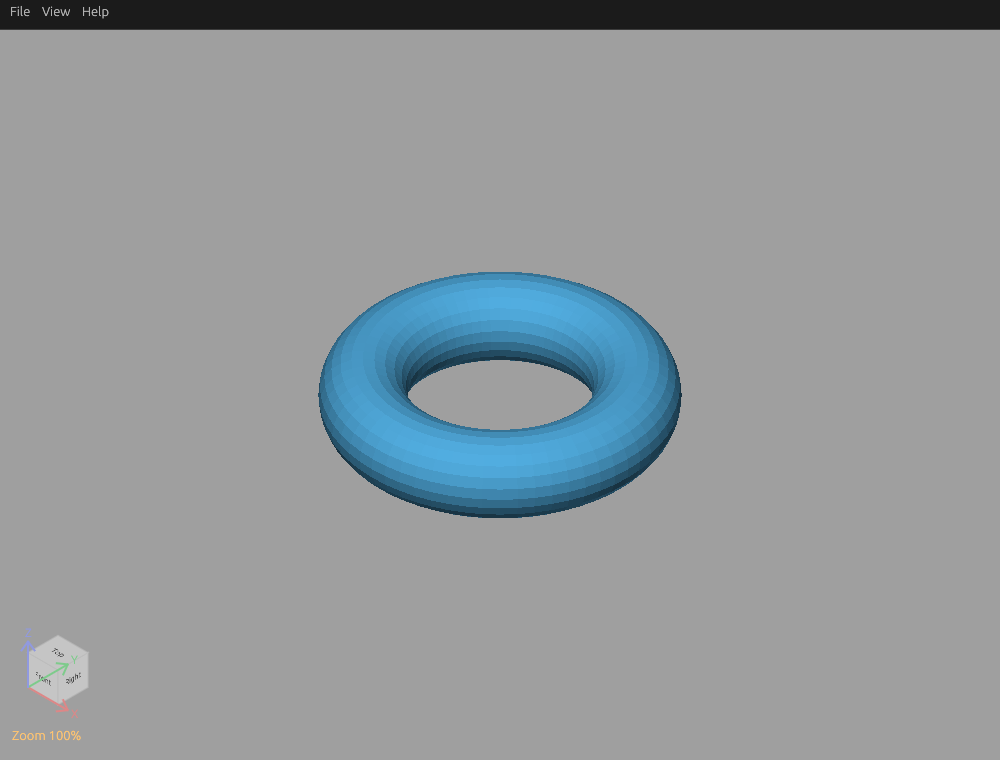

<h1 align="center">STL Viewer</h1>

  

English | <a href="README.zh-CN.md">简体中文</a>

## Intro

- **Binary: 8.0 MiB**
- **RAM: ~64 MiB**
- **Starts and opens STL files in under 10 ms (⚡ Rust + egui)** (~99% less CLI loading time than Bambu Studio)

A minimal, fast-starting native STL viewer for Linux (Wayland / X11), Windows and macOS, with x86_64 and ARM64 support in 0.4.x.

CLI startup and file loading times for three STL samples:

| Sample | STL Viewer | Bambu Studio | Blender |
| --- | ---: | ---: | ---: |
| A · 2.0 KiB | **1.5 ms** | 203.0 ms | 443.8 ms |
| B · 24.1 KiB | **1.6 ms** | 192.5 ms | 446.1 ms |
| C · 87.2 KiB | **1.4 ms** | 193.2 ms | 463.9 ms |

## Install

Choose the 0.4.x download for your OS and architecture from [GitHub Releases](https://github.com/ctxinf/stl-viewer-rs/releases/latest):

| Platform | Architectures | Package |
| --- | --- | --- |
| Linux | x86_64, ARM64 (aarch64 / arm64) | Debian / Ubuntu: `.deb`; Fedora: `.rpm`; Arch / Arch Linux ARM: `.pkg.tar.zst`; generic: `.tar.gz` |
| Windows | x86_64, ARM64 | Extract `.zip`, run `stl-viewer.exe` |
| macOS | Intel, Apple Silicon | Extract `.zip`, move `STL Viewer.app` to Applications |

Linux requires glibc 2.35+ and OpenGL 3.1+; macOS requires OpenGL 3.2+; Windows requires a graphics driver providing OpenGL 3.1+. ARM means 64-bit ARM; ARMv7 is not included. macOS bundles are ad-hoc signed and not notarized by Apple, so Gatekeeper may block the first launch. Windows binaries are unsigned.

Size, memory and timing figures above are earlier Linux x86_64 measurements; other platforms and architectures may differ. Build from source with `cargo build --release --locked`. For compatibility, the Cargo package and source-built executable remain named `stl-viewer-linux` (`.exe` on Windows).

Choose **View → Colors** to customize the background and model colors. Both are saved for future sessions and used in exported screenshots. Standard STL files contain geometry without model colors.
